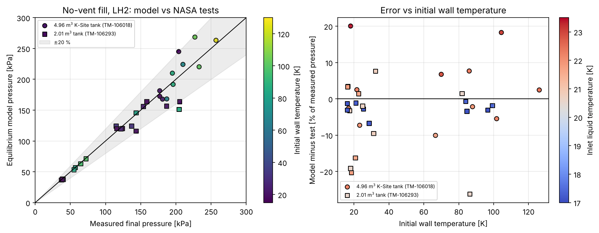
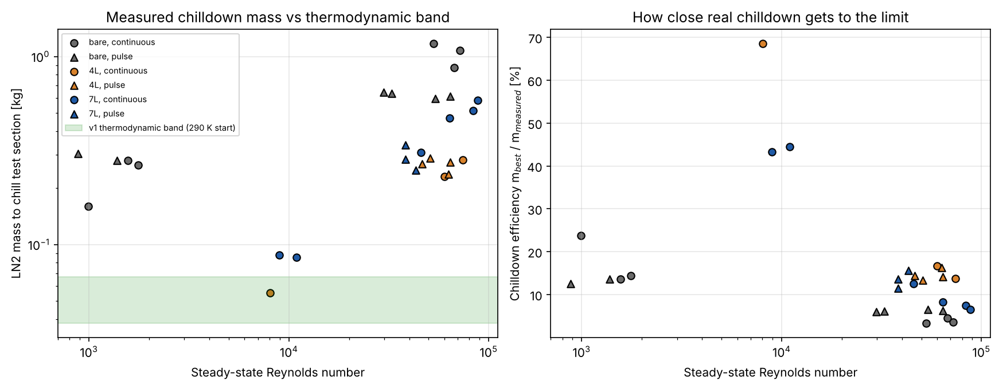
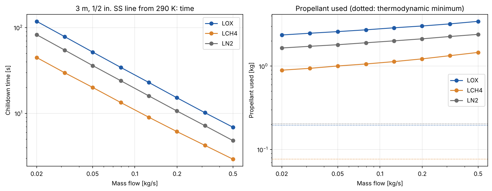
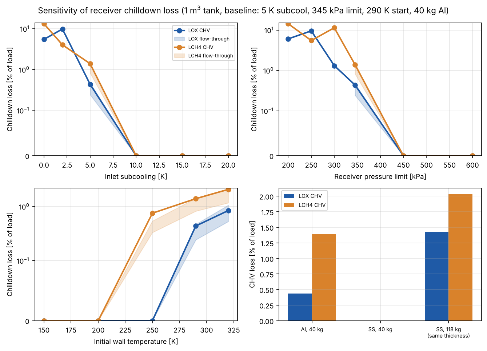

# Propellant loss and time in in-orbit LOX and LCH4 transfer: an energy-budget and transient model with NASA hydrogen validation

Thomas Farrugia, MEng Aerospace Engineering, University of Bristol. Draft of 2 November 2026. Code and data: github.com/ThomasFarri/TEC (private).

Status: draft for the author's review. Every number below is reproduced by the scripts in the repository.

## 1. Problem

Transferring cryogenic propellant between two spacecraft in orbit puts liquid into a warm receiver and a warm transfer line. The liquid cools the metal by boiling, and the vapour must be vented or condensed. The propellant lost this way, and the time it takes, set the usable mass delivered and the design of the transfer sequence. Most published test data are for liquid hydrogen (LH2), a little for nitrogen (LN2), and almost none for liquid oxygen (LOX) and liquid methane (LCH4), which are the fluids relevant to methalox vehicles.

The question for this note: for a methalox transfer, how large is the chilldown loss, how sensitive is it to the main design inputs, and how far can a simple model be trusted when it has only been checked against hydrogen and nitrogen?

## 2. Method

Three layers, from simple to detailed. Properties come from CoolProp (Helmholtz equations of state); specific heats of 6061 aluminium and 304 stainless steel come from NIST cryogenic fits.

**Equilibrium receiver model (v1).** A rigid tank holds fluid plus wall. Energy balance for open flows: dU = h_in dm_in - h_out dm_out, where U is fluid internal energy plus wall enthalpy. Fluid and wall are assumed to share one temperature and the fluid is homogeneous. Given the total mass and the total energy, the model solves for the common temperature and the pressure. Two chilldown strategies are modelled, followed by a no-vent fill to 95 % liquid volume:

- Charge-hold-vent (CHV): charge liquid to the pressure limit, equilibrate, vent to a low pressure, repeat until a no-vent fill can reach the target.
- Flow-through: cool the wall by continuous vented flow to the warmest wall temperature from which the no-vent fill still works. Vented gas enthalpy is bounded between saturated vapour (worst) and gas at wall temperature (best).

Equilibrium is a best case. It cannot predict stratification, so real tanks reach higher pressure for the same mass.

**Line chilldown bounds (v1).** The propellant needed to cool a line wall lies between two limits: vapour leaves at the local wall temperature (minimum) or as saturated vapour (maximum). The minimum is a true lower bound.

**Transient line chilldown (v2).** The tube is split into axial nodes. Each node has a lumped wall temperature (radial Biot number about 0.01 for the thin stainless tube), no axial conduction, and quasi-steady fluid. Heat flux follows film, transition and nucleate boiling correlations in the form of Darr and Hartwig (2019, NTRS 20190029114). One multiplier on film boiling, C_fb = 2.41, is calibrated on one LN2 flight test.

**Baseline case.** 1 m3 aluminium receiver, 40 kg wall, wall starts at 290 K, supply liquid at 400 kPa and 5 K subcooled, receiver limit 345 kPa, vent pressure 50 kPa, 95 % fill target. Transfer line: 3 m of half-inch, 0.89 mm wall 304 stainless tube.

## 3. Validation against NASA data

### 3.1 No-vent fill (LH2)

Thirty-two NASA Lewis no-vent fills in two tanks (4.96 m3 and 2.01 m3; Taylor and Chato; Chato, NASA TM-106293). The model is given the measured volume, wall mass, initial wall temperature, inlet temperature and final fill, and predicts final pressure.

| Tank set | Runs | Mean error | Mean absolute error | Max error |
|---|---|---|---|---|
| 4.96 m3 | 11 | +2.7 % | 7.7 % | 20 % |
| 2.01 m3 | 21 | -5.0 % | 6.6 % | 26 % |
| All | 32 | -2.3 % | 7.0 % | 26 % |

The biggest underpredictions (16 to 26 %) are spray-bar runs with warm inlet liquid, the signature of non-equilibrium. Most of the scatter is within the stated input uncertainty: final pressure follows the inlet saturation pressure at about 50 kPa per kelvin for LH2, and inlet temperature is known to about 0.5 K. One test failed on a pressure spike in the first seconds of wall cooldown, which an equilibrium model cannot see.

### 3.2 Line chilldown (LN2)

Twenty-eight parabolic-flight tests (Hartwig et al., npj Microgravity 2022) on a 0.914 m, 12.7 mm OD, 0.51 mm wall stainless tube. No test beats the v1 thermodynamic minimum, as it must. The ratio of minimum to measured mass (chilldown efficiency) ranges from 3.3 to 69 %. A bare tube at high flow is about 4 %; the best cases combine a thin coating with moderate flow. So the v1 band is a limit, not a prediction, and real lines use 1.5 to 30 times the minimum.

### 3.3 Transient model check

Calibrated on test F2 (14.6 s), the model gives 12.5 s (-17 %) and 19.1 s (-9 %) on the other two high-flow tests. At low flow (mass flux below about 40 kg/(m2 s)) it is 3 to 6 times too slow. It should not be used below about 300 kg/(m2 s) until checked against clean low-flow data. The calibration is for LN2; applying it to LOX and LCH4 is an extrapolation.

## 4. Results for LOX and LCH4

**Energy ratio.** The wall energy to remove, divided by the cooling capacity of the propellant load, is 2.9 % for LOX, 2.9 % for LCH4 and 24 % for LH2. This is why methalox is forgiving thermodynamically.

**Receiver chilldown loss (baseline, CHV).** LOX: 1 cycle, 4.4 kg of 1017 kg (0.44 %). LCH4: 2 cycles, 5.2 kg of 376 kg (1.4 %). LH2: 5 cycles, 1.6 kg of 61 kg (2.7 %), rising steeply with wall mass. Per kilogram loaded, methane costs about three times more than oxygen because its liquid is less dense.

**Line chilldown (3 m line).** Thermodynamic minimum 0.2 kg (LOX) and 0.08 kg (LCH4). The transient model gives 2.4 to 3.4 kg for LOX and 0.9 to 1.5 kg for LCH4 over 0.02 to 0.5 kg/s, taking 7 to 118 s (LOX), an efficiency of 6 to 9 %. Only the upper part of that flow range is inside the calibrated regime.

**Sensitivity (one at a time around the baseline).**

- Inlet subcooling is the strongest lever. LOX CHV loss is 5.5 % of load at 0 K, 0.44 % at 5 K and zero at 10 K. LCH4: 13 %, 1.4 %, zero.
- Receiver pressure limit acts the same way: at 450 kPa both fluids need no chilldown. This does not account for the heavier tank a higher rating requires.
- Initial wall temperature: LOX needs no chilldown from 250 K or colder; at 320 K the loss roughly doubles from 0.44 % to 0.84 %.
- Material: at equal mass, stainless steel needs no chilldown because its specific heat is half that of aluminium. At equal wall thickness it is 2.96 times heavier and the LOX loss is 1.4 % against 0.44 %. The honest answer needs structural sizing, which is outside this work.
- CHV loss is a staircase in whole cycles and not monotonic. Trends are read from the flow-through band.

The common cause is that the wall energy is only about 3 % of the load cooling capacity, so the system is near a threshold where a few percent change in capacity changes the number of cycles.

## 5. Limitations

1. Equilibrium receiver model is a best case. Validation shows underprediction of final pressure by up to 26 % for warm inlet and spray injection. Zero-loss thresholds in section 4 are therefore optimistic. Trends are more robust than thresholds.
2. All fill validation is LH2 at 30 to 55 kg/m3 wall mass. There is no LOX or LCH4 test comparison. The argument that equilibrium is better for methalox (smaller wall-to-load energy ratio) is an argument, not a validation.
3. Line chilldown validation is LN2 only, one tube geometry, with assumed initial wall temperature and outlet pressure. Chilldown efficiency depends on where the mass integration starts, which the source does not state.
4. The transient model is calibrated on one test and is wrong at low flow. Its film-boiling Reynolds number definition and the omission of the inverted-annular term are our choices, not the source's.
5. No heat leak, no line pressure drop, no tank and line interaction, no liquid venting. Liquid carry-over in microgravity would increase losses. No stratification, no sloshing.
6. The sensitivity study holds wall mass fixed when the pressure limit or material changes, and varies one input at a time, so interactions are not explored.
7. Properties at the high wall temperatures use the NIST cp fit held at its 300 K value above 300 K.

## 6. Questions for TEC

These are the questions where public data run out and real knowledge would change the model.

1. What receiver pressure limit and wall mass per unit volume are realistic for a methalox transfer receiver, and is the wall closer to aluminium, stainless steel or composite?
2. How much inlet subcooling can the donor supply? The model says 5 to 10 K decides whether receiver chilldown is needed at all.
3. What is the expected receiver temperature at the start of transfer, after a passive thermal soak? The model is strongly sensitive to it.
4. Is liquid venting in microgravity avoided by design (settling, capillary device, vent geometry), or is it a loss term to model?
5. Is there any LOX or LCH4 line chilldown data, from ground or flight tests, that could replace the LN2 calibration?
6. How are the line and the receiver chilled in the baseline concept: sequentially, or together with a single flow?

## 7. Conclusion

For a 1 m3 aluminium methalox receiver the equilibrium model puts chilldown loss at about 0.4 % (LOX) and 1.4 % (LCH4) of the load, and the line chilldown at a few kilograms. Both are small. Inlet subcooling, pressure limit and starting temperature decide whether they are zero. The model is validated on hydrogen to within 7 % mean absolute error in final pressure, with a worst case of 26 %, and these predictions should carry a margin of that order. The transient line model is only usable at high flow and has not been checked on LOX or LCH4.

## Sources

- Taylor, W.J., Chato, D.J., "Comparing the Results of an Analytical Model of the No-Vent Fill Process With No-Vent Fill Test Results for a 4.96 m3 (175 ft3) Tank", NASA TM-106018, 1993, NTRS 19930017966.
- Chato, D.J., "Ground Testing for the No-Vent Fill of Cryogenic Tanks: Results of Tests for a 71 Cubic Foot Tank", NASA TM-106293, AIAA-93-1967, 1993, NTRS 19940013013.
- Hartwig, J. et al., npj Microgravity 8:33 (2022), doi:10.1038/s41526-022-00220-9.
- Darr, S.R., Hartwig, J.W., Space Cryogenics Workshop 2019, NTRS 20190029114.
- NIST Cryogenic Material Properties, trc.nist.gov/cryogenics/materials. CoolProp, coolprop.org.

Full source list with NTRS IDs and every assumption: VALIDATION.md.
